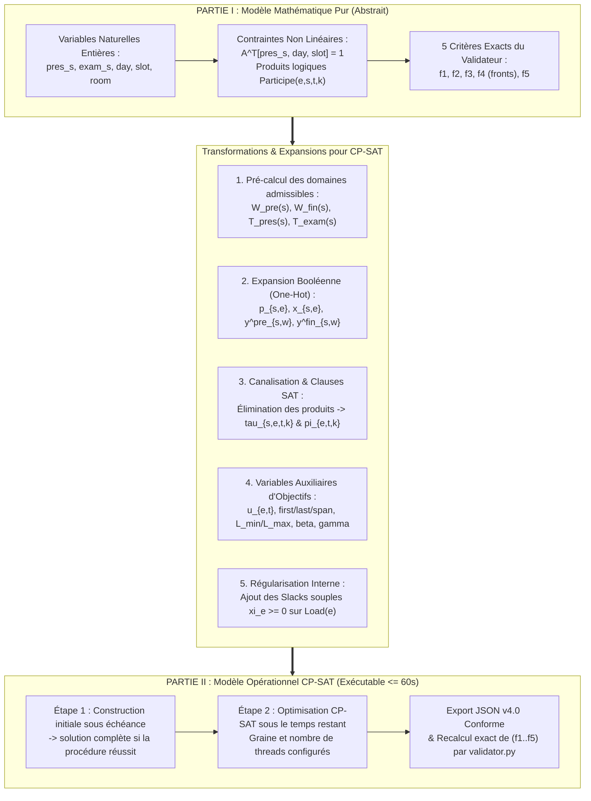

# Modélisation Mathématique et Passage au Modèle Opérationnel CP-SAT
## Planification Automatique des Jurys et Calendriers de Soutenances

**Année académique :** 2026 - 2027  
**Établissement :** Institut de Formation et de Recherche en Informatique (IFRI) / Université d'Abomey-Calavi  
**Cours :** Outils de résolution de problèmes d’optimisation (Licence 3 en Intelligence Artificielle)  
**Enseignant :** Dr Ing. (MC) Houndji Vinasetan Ratheil  

---

## 1. Introduction et Périmètre du Document

Ce document présente la conception théorique et algorithmique du module d'optimisation pour la planification automatique des soutenances. Afin de répondre rigoureusement aux exigences méthodologiques du sujet — qui demande de *« relier les règles métier au modèle »* et de *« distinguer la formulation du modèle des valeurs recalculées par le validateur »* —, l'étude est structurée en **deux grandes parties distinctes**, reliées par la méthode de référence :

* **PARTIE I — Le Modèle Mathématique Pur (Abstrait et Indépendant du Solveur) :**  
  Formalise les données, les décisions intrinsèques, les contraintes impératives et les cinq critères exacts tels que définis par les règles métier et le validateur officiel (`validator.py`), puis caractérise la complexité et la structure multiobjectif du problème.
* **MÉTHODE DE RÉFÉRENCE — Construction gloutonne sur le modèle pur :**  
  Affecte directement les variables naturelles de la Partie I, étudiant par étudiant, avec un ordre de traitement défini et le choix du premier placement compatible. Elle sert de point de comparaison et de solution initiale possible pour la Partie II.
* **PARTIE II — Du Modèle Mathématique Pur au Modèle Opérationnel CP-SAT (Modifications, Expansions et Résolution) :**  
  Détaille toutes les transformations mathématiques, pré-calcul et filtrage statique des domaines, expansions de variables booléennes, éliminations de produits non linéaires, variables auxiliaires de linéarisation et variables d'écart (*slacks*) nécessaires pour traduire le modèle pur en un modèle opérationnel résolu par **Google OR-Tools CP-SAT** sous le budget strict de 60 secondes.

---
---

# PARTIE I : LE MODÈLE MATHÉMATIQUE PUR
*(Formulation intrinsèque du problème, indépendante de la technique de résolution)*

## 2. Paramètres, Variables Naturelles et Contraintes Impératives

### 2.1. Données et Ensembles (Paramètres du Schéma v4.0)

#### Acteurs et Ressources
* $\mathcal{D}$ : Ensemble des domaines de spécialité scientifique (`domains`).
* $S$ : Ensemble des étudiants (`students`), indicés par $s$.
  * $d_s \in \mathcal{D}$ : Domaine de spécialité de l'étudiant $s$ (`domain`).
  * $sup_s \in T$ : Enseignant encadrant l'étudiant $s$ (`supervisor_id`), fixé par l'instance et agissant comme rapporteur en finale.
  * $elig_s \in \{0, 1\}$ : Indicateur d'admissibilité en finale ($1 \iff \text{eligible\_final} = \text{true}$).
  * $S_{elig} = \{s \in S \mid elig_s = 1\}$ : Sous-ensemble des étudiants admissibles en soutenance finale.
* $T$ : Ensemble des enseignants (`teachers`), indicés par $e$.
  * $P_e \in \{0, 1\}$ : Habilitation à présider ($1 \iff \text{"president"} \in \text{eligible\_roles}_e$).
  * $E_e \in \{0, 1\}$ : Habilitation à examiner ($1 \iff \text{"examiner"} \in \text{eligible\_roles}_e$).
  * $\mathcal{D}_e \subseteq \mathcal{D}$ : Sous-ensemble des domaines couverts par l'enseignant $e$ (`domains`).
  * $cap_e \in \mathbb{N}^*$ : Plafond journalier de séances de l'enseignant $e$ (`max_sessions_per_day`).
* $R$ : Ensemble des salles physiques (`rooms`), indicées par $r$ (utilisées exclusivement en finale).
  * $cap_r \in \mathbb{N}^*$ : Plafond journalier de séances de la salle $r$ (`max_sessions_per_day`).

#### Horizon Temporel et Disponibilités
* $D^{pre} \subset \{0, \dots, \text{days}-1\}$ : Ensemble non vide des jours de pré-soutenance (`predefence_days`).
* $D^{fin} \subset \{0, \dots, \text{days}-1\}$ : Ensemble non vide des jours de soutenance finale (`final_defence_days`).
  * *Propriétés :* $D^{pre} \cap D^{fin} = \emptyset$ et $\max(D^{pre}) < \min(D^{fin})$.
  * $D = D^{pre} \cup D^{fin}$ : Ensemble global des jours actifs des deux périodes.
* $K = \{0, 1, \dots, \text{slots\_per\_day} - 1\}$ : Ensemble ordonné des créneaux horaires unitaires $[k, k+1)$ d'une journée.
* Matrices binaires de disponibilité (valant $1$ si la ressource est disponible au jour $t$ et au créneau $k$, et $0$ sinon) :
  * $A^S_{s, t, k} \in \{0, 1\}$ pour l'étudiant $s \in S$.
  * $A^T_{e, t, k} \in \{0, 1\}$ pour l'enseignant $e \in T$.
  * $A^R_{r, t, k} \in \{0, 1\}$ pour la salle $r \in R$ ($t \in D^{fin}$).

---

### 2.2. Variables de Décision Naturelles du Modèle Pur

Dans le modèle mathématique pur, chaque étudiant $s \in S$ est associé aux variables de décision suivantes :

1. **Variables de composition du jury (communes aux deux phases) :**
   * $pres_s \in T$ : Enseignant désigné président du jury de l'étudiant $s$.
   * $exam_s \in T$ : Enseignant désigné examinateur du jury de l'étudiant $s$.

2. **Variables de planification de la pré-soutenance ($\forall s \in S$) :**
   * $day^{pre}_s \in D^{pre}$ : Jour de passage en pré-soutenance.
   * $slot^{pre}_s \in K$ : Créneau horaire de passage en pré-soutenance.
   *(Aucune variable de salle n'est associée : `room_id = null` en ligne).*

3. **Variables de planification de la soutenance finale ($\forall s \in S_{elig}$ uniquement) :**
   * $day^{fin}_s \in D^{fin}$ : Jour de passage en soutenance finale.
   * $slot^{fin}_s \in K$ : Créneau horaire de passage en soutenance finale.
   * $room_s \in R$ : Salle physique allouée à la soutenance finale.

---

### 2.3. Contraintes Impératives (Dures)

Une solution n'est recevable que si toutes les contraintes ci-dessous sont intégralement satisfaites.

#### A. Couverture, Habilitations, Domaines et Continuité des Jurys

0. **Couverture exacte des séances et modalité des salles :**  
   Garantie *par construction* des variables : chaque étudiant $s \in S$ possède exactement un couple $(day^{pre}_s, slot^{pre}_s)$ sans salle (`null`), chaque étudiant admissible $s \in S_{elig}$ possède exactement un triplet $(day^{fin}_s, slot^{fin}_s, room_s)$ avec $room_s \in R$, et les étudiants non admissibles ($s \notin S_{elig}$) n'ont aucune variable de finale.

1. **Habilitation du président :**
   $$\forall s \in S, \quad P_{pres_s} = 1$$

2. **Habilitation et compétence thématique de l'examinateur :**
   $$\forall s \in S, \quad E_{exam_s} = 1 \quad \land \quad d_s \in \mathcal{D}_{exam_s}$$

3. **Disjonction interne du jury en pré-soutenance :**
   $$\forall s \in S, \quad pres_s \neq exam_s$$

4. **Disjonction complète du jury en finale :**
   $$\forall s \in S_{elig}, \quad pres_s \neq exam_s \quad \land \quad pres_s \neq sup_s \quad \land \quad exam_s \neq sup_s$$

5. **Continuité stricte des jurys entre les deux phases :**  
   Garantie *par construction* : les variables $pres_s$ et $exam_s$ sont uniques pour chaque étudiant $s$ et partagées entre sa pré-soutenance et sa soutenance finale, rendant impossible tout changement de personne ou inversion de rôle.

#### B. Périodes Communes et Disponibilités

1. **Appartenance aux périodes communes et à l'horizon :**
   $$\forall s \in S, \quad day^{pre}_s \in D^{pre} \quad \land \quad slot^{pre}_s \in K$$
   $$\forall s \in S_{elig}, \quad day^{fin}_s \in D^{fin} \quad \land \quad slot^{fin}_s \in K$$

2. **Disponibilité de l'étudiant :**
   $$\forall s \in S, \quad A^S_{s, \, day^{pre}_s, \, slot^{pre}_s} = 1 \qquad \text{et} \qquad \forall s \in S_{elig}, \quad A^S_{s, \, day^{fin}_s, \, slot^{fin}_s} = 1$$

3. **Disponibilité des enseignants présents (indexation dépendante des variables) :**
   $$\forall s \in S, \quad A^T_{pres_s, \, day^{pre}_s, \, slot^{pre}_s} = 1 \quad \land \quad A^T_{exam_s, \, day^{pre}_s, \, slot^{pre}_s} = 1$$
   $$\forall s \in S_{elig}, \quad A^T_{pres_s, \, day^{fin}_s, \, slot^{fin}_s} = 1 \quad \land \quad A^T_{exam_s, \, day^{fin}_s, \, slot^{fin}_s} = 1 \quad \land \quad A^T_{sup_s, \, day^{fin}_s, \, slot^{fin}_s} = 1$$

4. **Disponibilité de la salle physique en finale :**
   $$\forall s \in S_{elig}, \quad A^R_{room_s, \, day^{fin}_s, \, slot^{fin}_s} = 1$$

#### C. Non-chevauchement des Ressources (Contraintes Disjonctives)

Définissons la fonction indicatrice $\mathbb{I}(\cdot) \in \{0, 1\}$ de participation de l'enseignant $e \in T$ à la séance de l'étudiant $s$ au créneau $(t, k)$ :
* En pré-soutenance ($t \in D^{pre}, \, s \in S$) :
  $$Participe^{pre}(e, s, t, k) = \mathbb{I}\Big((pres_s = e \lor exam_s = e) \land day^{pre}_s = t \land slot^{pre}_s = k\Big)$$
* En finale ($t \in D^{fin}, \, s \in S_{elig}$) :
  $$Participe^{fin}(e, s, t, k) = \mathbb{I}\Big((pres_s = e \lor exam_s = e \lor sup_s = e) \land day^{fin}_s = t \land slot^{fin}_s = k\Big)$$

1. **Non-chevauchement pour les enseignants et indicateur unifié $\pi_{e, t, k}$ :**  
   Un enseignant ne peut participer qu'à au plus une séance par créneau $(t, k)$ :
   $$\forall e \in T, \, \forall t \in D^{pre}, \, \forall k \in K : \quad \pi_{e, t, k} = \sum_{s \in S} Participe^{pre}(e, s, t, k) \le 1$$
   $$\forall e \in T, \, \forall t \in D^{fin}, \, \forall k \in K : \quad \pi_{e, t, k} = \sum_{s \in S_{elig}} Participe^{fin}(e, s, t, k) \le 1$$
   Sous les contraintes A.3, A.4 et $D^{pre} \cap D^{fin} = \emptyset$, $\pi_{e, t, k} \in \{0, 1\}$ indique exactement si l'enseignant $e$ est en séance au jour $t \in D$ et au créneau $k \in K$.

2. **Non-chevauchement pour les salles physiques :**  
   Une salle n'accueille qu'au plus une soutenance finale par créneau $(t, k)$ :
   $$\forall r \in R, \, \forall t \in D^{fin}, \, \forall k \in K : \quad \sum_{s \in S_{elig}} \mathbb{I}\Big(room_s = r \land day^{fin}_s = t \land slot^{fin}_s = k\Big) \le 1$$

3. **Non-chevauchement pour les étudiants :**  
   Garanti *par construction* : chaque étudiant $s$ n'a qu'un seul créneau dans $D^{pre}$ et au plus un créneau dans $D^{fin}$, avec $D^{pre} \cap D^{fin} = \emptyset$.

#### D. Plafonds Journaliers d'Activité (Daily Caps)

1. **Plafond journalier pour les enseignants (dans les deux phases) :**
   $$\forall e \in T, \, \forall t \in D : \quad \sum_{k \in K} \pi_{e, t, k} \le cap_e$$

2. **Plafond journalier pour les salles (en finale) :**
   $$\forall r \in R, \, \forall t \in D^{fin} : \quad \sum_{k \in K} \sum_{s \in S_{elig}} \mathbb{I}\Big(room_s = r \land day^{fin}_s = t \land slot^{fin}_s = k\Big) \le cap_r$$

---

## 3. Caractérisation Théorique et Formulation Pure des Objectifs

### 3.1. Typologie et Complexité du Problème
* **Classe de complexité :** Le problème appartient à la famille de l'**ordonnancement sous contraintes de ressources disjonctives et d'affectation multimode** (*Multi-Mode RCPSP / Timetabling*). Il est **NP-difficile au sens fort** (réduction depuis le *3-Dimensional Matching* pour l'affectation des jurys et la *coloration par listes de graphes d'intervalles* pour le placement temporel).
* **Couplage structurel Pré-soutenance / Finale :** La continuité obligatoire du couple $(pres_s, exam_s)$ interdit toute résolution séquentielle indépendante des deux phases. Un jury valide en pré-soutenance peut n'avoir aucune intersection de disponibilité avec l'encadrant $sup_s$ et les salles libres durant $D^{fin}$.

---

### 3.2. Formulation Mathématique Pure des Cinq Critères du Validateur

Le validateur officiel évalue tout planning valide selon le vecteur de cinq critères $\mathbf{f} = (f_1, f_2, f_3, f_4, f_5)$ à minimiser :

1. **$f_1$ (`teacher_presence_days`) — Jours de mobilisation des enseignants :**
   $$f_1 = \sum_{e \in T} \sum_{t \in D} u_{e, t} \quad \text{où} \quad u_{e, t} = \mathbb{I}\left(\sum_{k \in K} \pi_{e, t, k} \ge 1\right)$$

2. **$f_2$ (`teacher_idle_slots`) — Créneaux d'attente des enseignants :**  
   En notant $K_{e, t} = \{k \in K \mid \pi_{e, t, k} = 1\}$ l'ensemble des créneaux occupés par $e$ le jour $t$ :
   $$f_2 = \sum_{e \in T} \sum_{\substack{t \in D \\ u_{e, t} = 1}} \left( \max_{k \in K_{e, t}}(k) - \min_{k \in K_{e, t}}(k) + 1 - |K_{e, t}| \right)$$

3. **$f_3$ (`teacher_load_range`) — Écart de charge entre enseignants :**  
   Avec $Load(e) = \sum_{t \in D} \sum_{k \in K} \pi_{e, t, k}$ le nombre total de séances de $e \in T$ (enseignants inutilisés inclus) :
   $$f_3 = \max_{e \in T}\big(Load(e)\big) - \min_{e \in T}\big(Load(e)\big)$$

4. **$f_4$ (`supervisor_group_breaks`) — Dispersion des étudiants d'un même encadrant :**  
   Pour chaque encadrant $sup \in T$, un groupe est un bloc maximal de créneaux consécutifs :
   * En pré-soutenance, en posant $\alpha^{pre}_{sup, t, k} = \mathbb{I}\big(\exists s \in S : sup_s = sup \land day^{pre}_s = t \land slot^{pre}_s = k\big)$ et $\alpha^{pre}_{sup, t, -1} = 0$ :
     $$groupes^{pre}(sup) = \sum_{t \in D^{pre}} \sum_{k \in K} \mathbb{I}\Big(\alpha^{pre}_{sup, t, k} = 1 \land \alpha^{pre}_{sup, t, k-1} = 0\Big)$$
   * En finale, en posant $\alpha^{fin}_{sup, t, r, k} = \mathbb{I}\big(\exists s \in S_{elig} : sup_s = sup \land day^{fin}_s = t \land room_s = r \land slot^{fin}_s = k\big)$ et $\alpha^{fin}_{sup, t, r, -1} = 0$ :
     $$groupes^{fin}(sup) = \sum_{t \in D^{fin}} \sum_{r \in R} \sum_{k \in K} \mathbb{I}\Big(\alpha^{fin}_{sup, t, r, k} = 1 \land \alpha^{fin}_{sup, t, r, k-1} = 0\Big)$$
   * Total des ruptures sur l'ensemble des encadrants :
     $$f_4 = \sum_{sup \in T} \Big( \max\big(0, \, groupes^{pre}(sup) - 1\big) + \max\big(0, \, groupes^{fin}(sup) - 1\big) \Big)$$

5. **$f_5$ (`distinct_jury_pairs`) — Réutilisation des couples de jury :**
   $$f_5 = \big|\big\{(pres_s, exam_s) \mid s \in S\big\}\big| = \sum_{e_1 \in T} \sum_{\substack{e_2 \in T \\ e_2 \neq e_1}} \mathbb{I}\Big(\exists s \in S : pres_s = e_1 \land exam_s = e_2\Big)$$

---

### 3.3. Analyse Théorique des Conflits et Synergies Multiobjectifs

Le problème ne possède pas de solution utopique minimisant simultanément les cinq fonctions :
* **Antagonisme $f_3$ vs $f_5$ :** Minimiser $f_5$ concentre toutes les séances sur quelques couples $(pres, exam)$ récurrents, faisant exploser l'écart de charge $f_3$. Inversement, égaliser $Load(e)$ ($f_3 \to 0$) force à diversifier les jurys et dégrade $f_5$.
* **Antagonisme $f_1$ vs $f_2$ :** Regrouper les séances d'un enseignant sur peu de jours ($f_1 \downarrow$) crée des créneaux creux d'attente ($f_2 \uparrow$) lorsque les disponibilités croisées empêchent la contiguïté.
* **Synergie structurelle $\{f_1, f_2, f_4, f_5\}$ :** Affecter un **même binôme $(pres, exam)$** à plusieurs étudiants d'un **même encadrant $sup$** sur des **créneaux consécutifs $(k, k+1, \dots)$ le même jour et dans la même salle** réduit simultanément les ruptures de groupes ($f_4$), le nombre de binômes ($f_5$), l'attente ($f_2$) et les jours de venue ($f_1$).

---
---

# MÉTHODE DE RÉFÉRENCE : CONSTRUCTION GLOUTONNE SUR LE MODÈLE PUR
*(Méthode simple, explicable et déterministe ; code : `planification/soutenances/baseline.py`)*

## R.1. Principe

La méthode de référence n'utilise aucun solveur. Elle affecte directement les **variables naturelles** de la section 2.2, étudiant par étudiant : pour chaque $s \in S$, elle fixe le vecteur
$$\big(pres_s, \; exam_s, \; day^{pre}_s, \; slot^{pre}_s \;[, \; day^{fin}_s, \; slot^{fin}_s, \; room_s \text{ si } s \in S_{elig}]\big)$$
en une seule étape, sans jamais revenir sur un étudiant déjà placé, sauf lors de la réparation limitée (R.3, étape 4). Chaque affectation respecte toutes les contraintes de la section 2.3 : un planning complet est donc valide par construction.

Le jury et les deux créneaux sont choisis **ensemble**. C'est la conséquence directe du couplage décrit en 3.1 : un couple $(pres_s, exam_s)$ qui convient en pré-soutenance peut n'avoir aucun créneau commun avec $sup_s$ et une salle libre en finale. Traiter toutes les pré-soutenances, puis toutes les finales, exposerait à des impasses irréparables.

## R.2. Réduction statique des domaines

Avant toute affectation, on calcule pour chaque étudiant les ensembles $\mathcal{W}^{pre}_s$, $\mathcal{W}^{fin}_s$, $\mathcal{T}^{compat}_s$, $T^{pres}_s$ et $T^{exam}_s$ définis en 5.1. Ce filtrage ne dépend d'aucun solveur : il est **commun à la méthode de référence et au modèle CP-SAT**. On en déduit l'ensemble des couples de jury admissibles :
$$\mathcal{J}_s = \big\{(e_1, e_2) \in T^{pres}_s \times T^{exam}_s \;\big|\; e_1 \neq e_2\big\}$$

Les contraintes **A.1, A.2, A.3, A.4, B.1, B.2, B.4** et la disponibilité de l'encadrant dans **B.3** sont alors satisfaites par construction. A.0 et A.5 le sont par la représentation : une seule pré-soutenance par étudiant, une finale si et seulement si $s \in S_{elig}$, et un seul couple partagé par les deux phases.

## R.3. Algorithme

1. **Ordre des étudiants (« le plus contraint d'abord ») :** tri lexicographique selon
   $$\Big(\; s \notin S_{elig}, \;\; |\mathcal{J}_s|, \;\; |\mathcal{W}^{pre}_s| + |\mathcal{W}^{fin}_s|, \;\; \text{rang de } s \text{ dans le fichier} \;\Big)$$
   Les étudiants admissibles passent d'abord, car ils ont deux séances à placer, avec trois enseignants et une salle en finale. Viennent ensuite ceux qui ont le moins de jurys, puis le moins de créneaux possibles. C'est l'heuristique classique « échec d'abord » de la programmation par contraintes. Le rang dans le fichier ne sert qu'à départager les ex aequo de façon reproductible ; il n'a aucune signification métier.
2. **Ordre des couples de jury :** les couples $(e_1, e_2) \in \mathcal{J}_s$ sont essayés par $Load(e_1) + Load(e_2)$ croissant, où $Load$ est la charge courante, puis par rang dans le fichier. Cette règle évite de saturer toujours les mêmes enseignants : sans elle, on obtiendrait une référence volontairement dégradée, ce que le sujet exclut.
3. **Premier placement compatible :** pour le couple courant, on retient
   * le premier $(t, k) \in \mathcal{W}^{pre}_s$, dans l'ordre chronologique, tel que $e_1$ et $e_2$ soient libres ;
   * si $s \in S_{elig}$, le premier $(t, k, r) \in \mathcal{W}^{fin}_s$, dans l'ordre chronologique et avec les salles dans l'ordre du fichier, tel que $e_1$, $e_2$, $sup_s$ et la salle $r$ soient libres.

   Un enseignant $e$ est **libre** en $(t, k)$ si $A^T_{e,t,k} = 1$ (B.3), si $\pi_{e,t,k} = 0$ (C.1) et si $\sum_{k'} \pi_{e,t,k'} < cap_e$ (D.1). Une salle est **libre** si elle n'est pas occupée à ce créneau (C.2) et si son plafond du jour n'est pas atteint (D.2). Le premier couple qui obtient tous ses placements est retenu. Comme $D^{pre} \cap D^{fin} = \emptyset$, le choix de la pré-soutenance ne change pas l'occupation des jours de finale.
4. **Réparation limitée :** si aucun couple de $\mathcal{J}_s$ ne convient, on retire un étudiant $s'$ déjà placé (au plus 200 candidats, du plus récent au plus ancien). On place $s$, puis on replace $s'$ par la même règle gloutonne. Si l'une des deux opérations échoue, l'état précédent est restauré exactement et on passe au candidat suivant. Il n'y a qu'un niveau d'éjection, sans recherche arborescente.
5. **Arrêt :** planning complet (`COMPLETE`), échec de la réparation (`NO_SOLUTION`) ou budget de 60 secondes atteint (`TIME_LIMIT`).

La méthode n'utilise **aucune source d'aléa**. Elle est déterministe et s'exécute donc une seule fois par instance, comme le prévoit le protocole.

## R.4. Correspondance entre contraintes et mécanismes

| Contrainte (2.3) | Garantie par |
| :--- | :--- |
| A.0 Couverture exacte | La représentation : un vecteur par étudiant, une finale si et seulement si $s \in S_{elig}$ |
| A.1, A.2 Habilitations et domaine | Les domaines $T^{pres}_s$ et $T^{exam}_s$ |
| A.3, A.4 Distinction des membres | $e_1 \neq e_2$ dans $\mathcal{J}_s$, et $sup_s \notin \mathcal{T}^{compat}_s$ si $s \in S_{elig}$ |
| A.5 Continuité | Un seul couple $(pres_s, exam_s)$ partagé par les deux phases |
| B.1, B.2 Périodes et disponibilité de l'étudiant | Les domaines $\mathcal{W}^{pre}_s$ et $\mathcal{W}^{fin}_s$ |
| B.3 Disponibilité des enseignants | $\mathcal{W}^{fin}_s$ pour $sup_s$ ; test « libre » pour $pres_s$ et $exam_s$ |
| B.4 Disponibilité de la salle | Le domaine $\mathcal{W}^{fin}_s$ |
| C.1, D.1 Chevauchement et plafond des enseignants | Test « libre », avec suivi incrémental de $\pi_{e,t,k}$ |
| C.2, D.2 Chevauchement et plafond des salles | Test « libre » de la salle |
| C.3 Chevauchement d'un étudiant | Par construction : une séance par phase et $D^{pre} \cap D^{fin} = \emptyset$ |

## R.5. Contrôles et distinction entre modèle et validateur

Pour chaque planning produit :
1. les contraintes A.0 à D.2 sont revérifiées directement sur la solution, avec des messages qui portent leur étiquette ;
2. les critères $f_1$ à $f_5$ sont calculés par les formules de la section 3.2 : ce sont les **valeurs calculées par le modèle** ;
3. le planning est exporté en JSON, **relu depuis le disque** et soumis à `validator.py`, qui produit les **valeurs recalculées par le validateur**.

Sur les 30 instances, les deux séries de valeurs sont **identiques**, ce qui confirme l'exactitude de la formulation de la section 3.2. Seules les valeurs du validateur sont reportées dans le tableau de résultats.

## R.6. Complexité et résultats

Dans le pire cas, l'insertion d'un étudiant coûte $O\big(|\mathcal{J}_s| \cdot (|\mathcal{W}^{pre}_s| + |\mathcal{W}^{fin}_s|)\big)$ tests élémentaires. En pratique, la recherche s'arrête dès le premier placement compatible.

Campagne sur les 30 instances (une exécution par instance, budget de 60 s, un thread) :
* **30 plannings valides sur 30** ; temps total de résolution maximal : **0,42 s** ;
* la réparation ne s'est déclenchée **sur aucune instance** : le glouton seul a suffi. Elle est vérifiée par un test sur un cas construit pour la provoquer.

| Taille | $f_1$ présence | $f_2$ attente | $f_3$ écart de charge | $f_4$ ruptures encadrant | $f_5$ couples distincts |
| :--- | ---: | ---: | ---: | ---: | ---: |
| Petite (médiane) | 46,5 | 23 | 4 | 14 | 14,5 |
| Moyenne (médiane) | 122 | 86 | 4 | 44 | 40 |
| Grande (médiane) | 275 | 222 | 7 | 114,5 | 88 |

## R.7. Limites assumées

* La méthode **n'optimise aucun critère** ; seule la règle de charge de R.3 (étape 2) limite $f_3$. $f_5$ reste proche du nombre d'étudiants, car les jurys sont rarement réutilisés, et $f_2$ comme $f_4$ restent élevés. C'est la marge que doit exploiter la Partie II.
* Un échec de la méthode **ne prouverait pas** l'irréalisabilité d'une instance : il signifierait seulement « aucune solution trouvée par cette construction ».
* La méthode sert d'étalon de comparaison exclusif (baseline) face au modèle d'optimisation CP-SAT, qui résout le problème de manière 100 % autonome et indépendante.

---
---

# PARTIE II : DU MODÈLE MATHÉMATIQUE PUR AU MODÈLE OPÉRATIONNEL CP-SAT
*(Modifications, expansions, linéarisations et choix algorithmiques pour la résolution)*

## 4. Pourquoi Transformer le Modèle Mathématique Pur ?

Le modèle mathématique pur de la Partie I ne peut pas être injecté tel quel dans un solveur d'optimisation pour trois raisons fondamentales :
1. **Explosion combinatoire des domaines naïfs :** Sur les grandes instances ($136$ étudiants, $50$ enseignants, $10$ jours, $10$ créneaux), croiser aveuglément $T \times D \times K \times R$ génère des dizaines de millions de tuples majoritairement invalides.
2. **Non-linéarités et indexations variables :** Les contraintes B.3 ($A^T_{pres_s, day^{pre}_s, slot^{pre}_s} = 1$), C.1 (produit logique entre le choix d'enseignant $pres_s = e$ et le choix temporel $day^{pre}_s = t \land slot^{pre}_s = k$) et les cinq critères $f_1 \dots f_5$ (opérateurs $\mathbb{I}(\cdot)$, $\max$, $\min$, cardinalité) sont non linéaires dans les variables naturelles.
3. **Risque d'infaisabilité ou de mauvaise mise à l'échelle multiobjectif :** Optimiser cinq critères antagonistes sous un budget strict de 60 secondes exige une formulation correcte et une stratégie d'objectif explicitement documentée. Une déclaration `INFEASIBLE` du solveur concerne le modèle encodé et doit être analysée avant toute conclusion métier.

Voici l'ensemble des **modifications, expansions et ajouts** apportés au modèle pur pour construire notre modèle opérationnel **Google OR-Tools CP-SAT**.

---

## 5. Modifications et Expansions Structurelles Imposées par CP-SAT

### 5.1. Modification 1 — Pré-calcul et filtrage statique des domaines admissibles

Avant toute création de variable dans CP-SAT, le code pré-calcule les placements compatibles avec les disponibilités de chaque étudiant et de son encadrant, puis filtre les enseignants candidats selon leurs disponibilités et habilitations. Il s’agit d’un filtrage statique par intersections de domaines, et non de l’algorithme général AC-3 (qui nécessiterait une propagation répétée de contraintes binaires entre variables).

1. **Compression des fenêtres spatio-temporelles en ensembles de configurations valides :**  
   Au lieu de manipuler des ensembles séparés $D^{pre}, D^{fin}, K, R$, on pré-calcule pour chaque étudiant $s$ les ensembles finis de placements compatibles :
   $$\mathcal{W}^{pre}_s = \Big\{w = (t, k) \in D^{pre} \times K \;\Big|\; A^S_{s, t, k} = 1\Big\}$$
   $$\mathcal{W}^{fin}_s = \Big\{w = (t, k, r) \in D^{fin} \times K \times R \;\Big|\; A^S_{s, t, k} = 1 \land A^T_{sup_s, t, k} = 1 \land A^R_{r, t, k} = 1\Big\} \quad (\forall s \in S_{elig})$$
   *Conséquence :* Les contraintes dures **B.1, B.2, B.4** et la disponibilité de l'encadrant $sup_s$ en **B.3** sont **intégralement absorbées** par cette réduction et disparaissent du système d'équations !

2. **Filtrage croisé des enseignants candidats :**  
   Un enseignant $e \in T$ n'est conservé pour l'étudiant $s$ que s'il possède au moins un créneau commun dans $\mathcal{W}^{pre}_s$ et (si $s \in S_{elig}$) dans $\mathcal{W}^{fin}_s$ :
   $$\mathcal{T}^{compat}_s = \Big\{e \in T \;\Big|\; \big(\exists (t, k) \in \mathcal{W}^{pre}_s : A^T_{e, t, k} = 1\big) \land \big(elig_s = 0 \lor [e \neq sup_s \land \exists (t, k, r) \in \mathcal{W}^{fin}_s : A^T_{e, t, k} = 1]\big)\Big\}$$
   $$T^{pres}_s = \Big\{e \in \mathcal{T}^{compat}_s \;\Big|\; P_e = 1\Big\}, \qquad T^{exam}_s = \Big\{e \in \mathcal{T}^{compat}_s \;\Big|\; E_e = 1 \land d_s \in \mathcal{D}_e\Big\}$$
   *Conséquence :* Les contraintes dures **A.1, A.2** et la disjonction avec $sup_s$ en **A.4** sont elles aussi satisfaites par construction des domaines filtrés !

---

### 5.2. Modification 2 — Expansion Booléenne des Variables de Décision (*One-Hot Encoding*)

Dans le solveur CP-SAT, les variables entières $(pres_s, exam_s, day^{pre}_s, slot^{pre}_s, day^{fin}_s, slot^{fin}_s, room_s)$ du modèle pur sont **remplacées (ou canalisées)** par des variables booléennes creuses définies uniquement sur les domaines pré-filtrés :

* **Sélection du président :** $p_{s, e} \in \{0, 1\}$ pour tout $s \in S$ et $e \in T^{pres}_s$, avec la contrainte de partition :
  $$\sum_{e \in T^{pres}_s} p_{s, e} = 1 \quad (\text{implémentée par } \texttt{AddExactlyOne})$$
* **Sélection de l'examinateur :** $x_{s, e} \in \{0, 1\}$ pour tout $s \in S$ et $e \in T^{exam}_s$, avec :
  $$\sum_{e \in T^{exam}_s} x_{s, e} = 1 \quad (\texttt{AddExactlyOne})$$
* **Sélection du créneau de pré-soutenance :** $y^{pre}_{s, w} \in \{0, 1\}$ pour tout $s \in S$ et $w = (t, k) \in \mathcal{W}^{pre}_s$, avec :
  $$\sum_{w \in \mathcal{W}^{pre}_s} y^{pre}_{s, w} = 1 \quad (\texttt{AddExactlyOne})$$
* **Sélection du triplet (jour, créneau, salle) de finale :** $y^{fin}_{s, w} \in \{0, 1\}$ pour tout $s \in S_{elig}$ et $w = (t, k, r) \in \mathcal{W}^{fin}_s$, avec :
  $$\sum_{w \in \mathcal{W}^{fin}_s} y^{fin}_{s, w} = 1 \quad (\texttt{AddExactlyOne})$$

#### Traduction immédiate des contraintes de disjonction de jury et de salle :
* **Disjonction Président $\neq$ Examinateur (A.3 & A.4) :** Pour tout $e \in T^{pres}_s \cap T^{exam}_s$ :
  $$p_{s, e} + x_{s, e} \le 1$$
* **Non-chevauchement des salles (C.2) :** Pour tout $(t, k, r) \in D^{fin} \times K \times R$ :
  $$\sum_{s \in S_{elig} : (t, k, r) \in \mathcal{W}^{fin}_s} y^{fin}_{s, (t, k, r)} \le 1 \quad (\texttt{AddAtMostOne})$$

---

### 5.3. Modification 3 — Élimination des Produits Non Linéaires et Simplification Structurelle

Dans le modèle pur, la contrainte B.3 ($A^T_{pres_s, day^{pre}_s, slot^{pre}_s} = 1$) et la participation $Participe(e, s, t, k)$ multiplient le choix d'enseignant par le choix de créneau. En CP-SAT, nous les reformulons linéairement par **pré-calcul d'indicateur de rôle**, **clauses d'incompatibilité directes** et **variables de présence canalisées** :

1. **Pré-calcul unique de l'affectation du rôle $role_{s, e}$ :**  
   Pour chaque paire $(s, e)$, un booléen $role_{s, e} \in \{0, 1\}$ indique si l'enseignant $e$ fait partie du jury de $s$ (comme président ou examinateur) :
   $$role_{s, e} = p_{s, e} + x_{s, e}$$
   Ce pré-calcul unique réduit drastiquement le nombre de variables auxiliaires et permet d'exprimer toutes les contraintes de disponibilité et de présence sans duplication.

2. **Clauses directes d'indisponibilité enseignant (Traduction compacte de B.3) :**  
   Si un enseignant $e \in T^{pres}_s \cup T^{exam}_s$ est indisponible au créneau $(t, k)$ ($A^T_{e, t, k} = 0$), il ne peut pas être membre du jury si l'étudiant $s$ est placé à ce créneau. Cela s'exprime par une clause binaire `AddAtMostOne` à 2 littéraux :
   $$\forall w = (t, k) \in \mathcal{W}^{pre}_s \text{ tel que } A^T_{e, t, k} = 0 : \quad \texttt{AddAtMostOne}([role_{s, e}, \, y^{pre}_{s, w}])$$
   $$\forall s \in S_{elig}, \, \forall (t, k) \text{ tel que } A^T_{e, t, k} = 0 : \quad \texttt{AddAtMostOne}([role_{s, e}, \, z^{fin}_{s, t, k}])$$
   où $z^{fin}_{s, t, k} = \sum_{r : (t, k, r) \in \mathcal{W}^{fin}_s} y^{fin}_{s, (t, k, r)} \in \{0, 1\}$.

3. **Variables auxiliaires de participation et indicateur unifié $\pi_{e, t, k}$ (Traduction de C.1) :**  
   Pour chaque créneau où $A^T_{e, t, k} = 1$, la participation effective $\tau_{s, e, t, k} \in \{0, 1\}$ est canalisée de façon compacte via l'égalité multiplicative native :
   * **En pré-soutenance ($t \in D^{pre}$) :** $\tau_{s, e, t, k} = role_{s, e} \cdot y^{pre}_{s, (t, k)} \quad (\texttt{AddMultiplicationEquality})$.
   * **En finale ($t \in D^{fin}, \, s \in S_{elig}$) :**  
     - Si $e = sup_s$ (encadrant obligatoirement présent en finale) : $\tau_{s, sup_s, t, k} = z^{fin}_{s, t, k}$.  
     - Si $e \neq sup_s$ : $\tau_{s, e, t, k} = role_{s, e} \cdot z^{fin}_{s, t, k} \quad (\texttt{AddMultiplicationEquality})$.
   * **Clause de non-chevauchement et définition de $\pi_{e, t, k}$ :**
     $$\forall e \in T, \, \forall t \in D, \, \forall k \in K \text{ tel que } A^T_{e, t, k} = 1 : \quad \pi_{e, t, k} = \sum_{s} \tau_{s, e, t, k} \le 1 \quad (\texttt{AddAtMostOne})$$

---

### 5.4. Modification 4 — Expansion et Linéarisation Sans *Big-M* des Cinq Objectifs

Pour que CP-SAT puisse calculer une borne inférieure linéaire serrée et propager sur les critères de qualité, chaque fonction non linéaire $f_1 \dots f_5$ du modèle pur est étendue par l'ajout de **variables auxiliaires dédiées** :

| Critère du modèle pur | Variables auxiliaires ajoutées dans CP-SAT | Contraintes linéaires / booléennes injectées dans CP-SAT |
| :--- | :--- | :--- |
| **$f_1$ (Présence)** $\mathbb{I}(\sum_k \pi_{e, t, k} \ge 1)$ | Booléen de venue journalière : $u_{e, t} \in \{0, 1\}, \; \forall (e, t) \in T \times D$ | $\forall k \in K : \pi_{e, t, k} \le u_{e, t}$ $u_{e, t} \le \sum_{k \in K} \pi_{e, t, k}$ *(ou `AddMaxEquality`)* **Expression CP-SAT :** $f_1 = \sum_{e, t} u_{e, t}$ |
| **$f_2$ (Attente)** $\max_{k} k - \min_{k} k + 1 - |K_{e,t}|$ | Bornes d'amplitude journalière : $first_{e, t}, \, last_{e, t} \in [0, |K|-1]$ $span_{e, t} \in [0, |K|]$ | Canalisation conditionnelle (`OnlyEnforceIf`) : $\pi_{e, t, k} = 1 \implies first_{e, t} \le k \text{ et } last_{e, t} \ge k$ $u_{e, t} = 1 \implies span_{e, t} \ge last_{e, t} - first_{e, t} + 1$ $u_{e, t} = 0 \implies span_{e, t} = 0$ **Expression CP-SAT :** $f_2 = \sum_{e, t} \big(span_{e, t} - \sum_{k \in K} \pi_{e, t, k}\big)$ |
| **$f_3$ (Écart de charge)** $\max_e Load(e) - \min_e Load(e)$ | Deux bornes entières globales : $L_{\min}, \, L_{\max} \in [0, 2|S|]$ | $\forall e \in T : L_{\min} \le Load(e) \le L_{\max}$ Les bornes sont resserrées par la minimisation de leur différence ; le code n'utilise pas `AddMinEquality` / `AddMaxEquality` ici. **Expression CP-SAT :** $f_3 = L_{\max} - L_{\min}$ |
| **$f_4$ (Ruptures encadrant)** Fronts montants $\alpha_k = 1 \land \alpha_{k-1} = 0$ | Occupation $\alpha^{pre}_{sup, t, k} \in \{0, 1\}$ Fronts montants : $\beta^{pre}_{sup, t, k} \in \{0, 1\}$ $\beta^{fin}_{sup, t, r, k} \in \{0, 1\}$ Dépassements $brk^{pre}_{sup}, brk^{fin}_{sup} \ge 0$ | $\alpha^{pre}_{sup, t, k} = \max_{s : sup_s = sup} y^{pre}_{s, (t, k)}$ $\alpha^{fin}_{sup, t, r, k} = \sum_{s \in S_{elig} : sup_s = sup} y^{fin}_{s, (t, k, r)}$ Inégalités de front montant (sans produit) : $\beta^{pre}_{sup, t, k} \ge \alpha^{pre}_{sup, t, k} - \alpha^{pre}_{sup, t, k-1}$ $\beta^{fin}_{sup, t, r, k} \ge \alpha^{fin}_{sup, t, r, k} - \alpha^{fin}_{sup, t, r, k-1}$ $brk^{pre}_{sup} \ge \sum_{t, k} \beta^{pre}_{sup, t, k} - 1$, $\; brk^{fin}_{sup} \ge \sum_{t, r, k} \beta^{fin}_{sup, t, r, k} - 1$ **Expression CP-SAT :** $f_4 = \sum_{sup \in T} (brk^{pre}_{sup} + brk^{fin}_{sup})$ |
| **$f_5$ (Couples distincts)** $\big|\{(pres_s, exam_s)\}\big|$ | Booléen d'activation du couple : $\gamma_{e_1, e_2} \in \{0, 1\}, \; \forall (e_1, e_2)$ viable | $\forall s \in S : \gamma_{e_1, e_2} \ge p_{s, e_1} + x_{s, e_2} - 1$ **Expression CP-SAT :** $f_5 = \sum_{e_1 \neq e_2} \gamma_{e_1, e_2}$ |

---

### 5.5. Modification 5 — Ajout des Variables d'Écart Souples (*Slacks*) et Fonction Objectif Interne vs Validateur

Conformément à l'exigence du sujet (*« Distinguer une valeur calculée par votre modèle d’une valeur recalculée sur le planning par le validateur »*), nous distinguons :

1. **Les 5 métriques exactes du validateur $(f_1, f_2, f_3, f_4, f_5)$ :**  
   Elles sont calculées sans aucune approximation par les expressions du tableau 5.4 et recalculées a posteriori par `validator.py` sur le fichier JSON exporté.
2. **L'ajout de variables de régularisation souples (*slacks* $\xi_e \ge 0$) propres au modèle CP-SAT :**  
   Soit $\bar{L} = \frac{2|S| + 3|S_{elig}|}{|T|}$ la charge moyenne théorique. Comme certains enseignants peuvent n'avoir aucune habilitation (ex. `ENS-D` avec $0$ séance dans la démo) ou au contraire encadrer beaucoup d'étudiants, imposer une borne dure sur $Load(e)$ risquerait de rendre l'instance `INFEASIBLE`. Nous ajoutons donc pour chaque enseignant $e \in T$ une variable d'écart de surcharge $\xi_e \in \mathbb{N}$ :
   Le code calcule $\Delta_{cible} = \max(2, \operatorname{round}(0{,}35\bar{L}))$ et $seuil = \operatorname{int}(\bar{L}) + \Delta_{cible}$, puis impose :
   $$\forall e \in T, \quad Load(e) \le seuil + \xi_e, \qquad \xi_e \ge 0$$
3. **La fonction objectif interne $\mathcal{F}_{interne}$ minimisée par CP-SAT :**
   $$\min \mathcal{F}_{interne} = w_1 f_1 + w_2 f_2 + w_3 f_3 + w_4 f_4 + w_5 f_5 + w_{\xi} \sum_{e \in T} \xi_e$$
   avec $(w_1, w_2, w_3, w_4, w_5, w_{\xi}) = (100, \, 10, \, 5, \, 8, \, 15, \, 20)$.  
   Le terme de pénalité $w_{\xi} \sum_e \xi_e$ est un mécanisme **purement interne au modèle d'optimisation** : il lisse la répartition de charge entre les enseignants sans jamais sacrifier la faisabilité, tandis que seules les cinq métriques officielles $(f_1, f_2, f_3, f_4, f_5)$ sont rapportées dans le bilan expérimental.

---

## 6. Choix et Architecture de la Résolution Interne (Google OR-Tools CP-SAT)

### 6.1. Justification du choix de CP-SAT

CP-SAT est retenu parce que le problème comporte de nombreuses décisions booléennes, des contraintes de cardinalité (`ExactlyOne`, `AtMostOne`), des incompatibilités et une fonction objectif entière. Cette structure se prête naturellement à la programmation par contraintes. Ce choix ne garantit toutefois ni une solution dans le budget, ni l'optimalité : ces propriétés doivent être établies par les résultats et les statuts du solveur.

### 6.2. Architecture de résolution en deux phases sous une échéance commune

Le code applique une échéance unique au travail de résolution, après le chargement des données. La construction du modèle CP-SAT est mesurée par le programme d'exécution (`build_seconds`) ; le temps restant est transmis à `CPSATSolver.solve()`.

1. **Construction d'une affectation initiale :** une procédure constructive trie les étudiants en donnant la priorité aux étudiants admissibles en finale, puis aux étudiants ayant le moins de couples de jury candidats et les domaines de placement les plus restreints. Elle essaie les placements compatibles et peut retirer puis réinsérer un étudiant déjà placé (au plus 200 tentatives de réparation). Cette procédure peut échouer ou atteindre l'échéance ; elle ne garantit donc pas une solution pour chaque instance. Lorsqu'elle réussit, l'affectation complète est conservée et injectée au modèle CP-SAT avec `AddHint()`.

2. **Optimisation CP-SAT :** si du temps reste (plus de 0,01 seconde), le solveur est lancé avec `max_time_in_seconds` égal au temps restant, la graine `random_seed` fournie, le nombre de threads demandé et `cp_model_probing_level = 0`. Le solveur optimise la somme pondérée décrite en §5.5. La meilleure solution complète connue (affectation initiale ou solution retournée par le callback) est conservée.

3. **Interprétation des statuts :**
   - `OPTIMAL` : CP-SAT a prouvé l'optimalité de son modèle et de sa fonction objectif interne ; cela ne signifie pas que chaque critère officiel est individuellement optimal.
   - `FEASIBLE` : une solution complète a été trouvée, sans preuve d'optimalité.
   - `FEASIBLE_TIME_LIMIT` : une solution complète initiale est conservée, mais CP-SAT n'a pas pu terminer une recherche dans le temps restant.
   - `TIME_LIMIT` : l'échéance est atteinte sans solution complète connue.
   - `INFEASIBLE` : CP-SAT a prouvé que le modèle encodé n'a pas de solution. Ce statut ne doit pas être interprété comme une preuve concernant le problème métier si le modèle comporte une erreur.
   - `MODEL_INVALID` : OR-Tools a rejeté la formulation du modèle.
   - `MODEL_CONFLICT` : l'affectation constructive complète existe, mais CP-SAT déclare le modèle infaisable ; cette contradiction signale une incohérence à investiguer dans la formulation.
   - `NO_SOLUTION` : la recherche se termine sans solution complète et sans statut d'infaisabilité certifiée.

La graine et le nombre de threads sont consignés pour permettre de reproduire les paramètres. Une graine fixe ne garantit pas à elle seule des résultats identiques entre versions, plateformes ou configurations multithread. Le programme d'exécution ajoute `build_seconds` au temps renvoyé par CP-SAT pour que `first_feasible_seconds` soit mesuré depuis le début du budget de résolution.

---

## 7. Synthèse Visuelle : Du Modèle Mathématique Pur au Modèle CP-SAT

